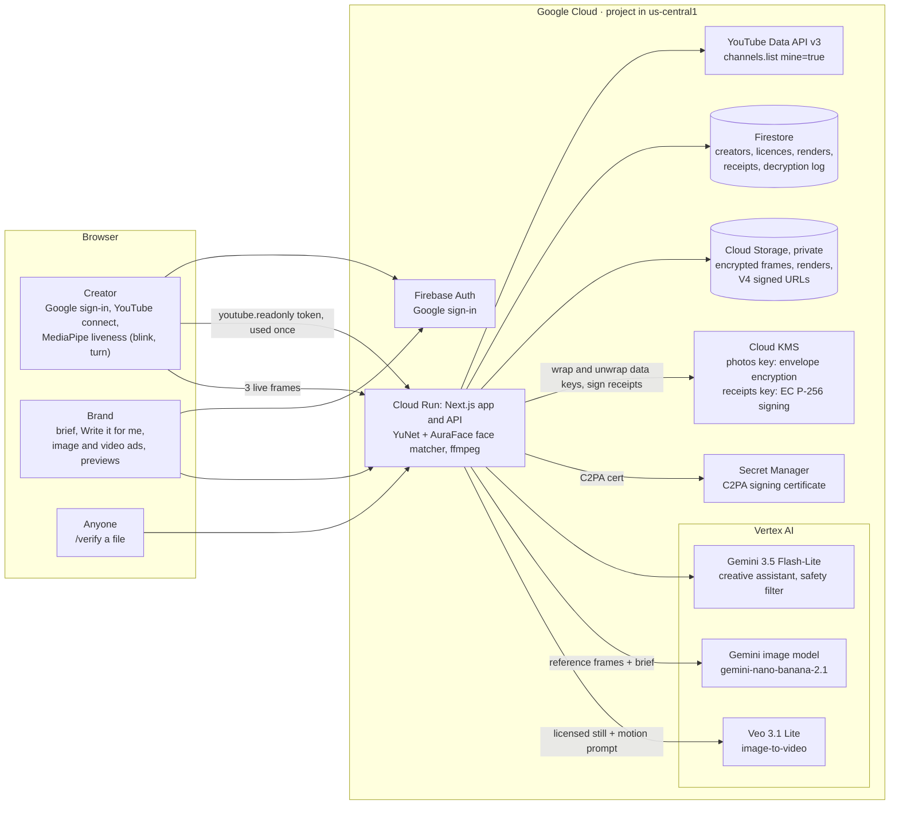

# Likeness AI

**Your face. Your terms. Verified by your channel.**

Creators license their face for AI image and video ads, on their terms. Brands make consented ads in
minutes. Anyone can check whether an ad was licensed.

- **Demo video:** \<DEMO_URL\>
- **Live:** https://likeness-1000899129252.us-central1.run.app
- **Built for:** the AI Builder Cup 2026 (Hack2skill × Google Cloud), theme *Media, Content & Digital Experiences*
- **Runs on:** Google Cloud: Vertex AI (Gemini, Veo 3.1 Lite), Firebase Auth with YouTube, Firestore,
  Cloud KMS, Cloud Storage, Secret Manager, Cloud Run

## The problem

- **Ad shoots take days.** A short social ad with a real person needs casting, a shoot, a location and
  edits, so it takes days and a budget most small brands don't have.
- **Faces are used without consent.** Creators find their face in ads they never agreed to, made from
  scraped photos. They have no way to say yes on their own terms, or to say no.
- **Deepfakes make every ad suspect.** Viewers, platforms and the creators themselves can't tell a
  licensed AI ad from a fake one.

## The solution

Likeness AI turns consent into something a render can't skip:

1. **Creators prove it's them.** They sign in with Google, connect their YouTube channel (YouTube
   confirms they own it), and pass a live face check (blink, turn) matched to the channel's avatar.
   Their three live frames are encrypted with their own key in Cloud KMS.
2. **Creators set their terms.** Allowed uses, a price per image and per video (suggested from their
   audience size), how many renders, and whether video is allowed. Political, adult, minor-involving,
   impersonating and deceptive uses are refused under every licence.
3. **Brands request, creators approve.** Every licence is approved by the creator, one brand at a time.
4. **Brands make ads in minutes.** "✨ Write it for me" drafts a detailed prompt. Gemini renders an image
   ad from the creator's protected photos, and Veo 3.1 Lite animates it into a video ad. Each render is
   paid in demo credits (90% to the creator).
5. **Every ad carries its proof.** Each file is visibly labelled "AI-generated · licensed likeness". It
   carries a C2PA content credential and a receipt signed by Cloud KMS. Anyone can check it on
   `/verify`: **Licensed**, **Expired**, **Revoked** or **Unknown**.
6. **Creators stay in control.** They can revoke a licence at any time, after which new renders are refused. They see every ad made
   with their face and every time their photos were opened.

## Architecture



The app is one Next.js 16 service on Cloud Run, running as a least-privilege service account. It calls Google
APIs with that service account, with no API keys. It is the only identity that can unwrap a
creator's photo key. Cloud Build builds the image, and Artifact Registry stores it.

**An image ad, end to end:**
1. **Checks:** the licence is active and held by this brand, it has renders left, the brand has the
   credits, and the daily cap isn't reached.
2. **Safety filter:** local banned-use rules, then a Gemini classifier that also checks the prompt fits
   the licensed use. It fails closed.
3. **Photos opened:** the creator's frames are opened for this one render; the access is logged in
   Firestore and in Cloud KMS audit logs.
4. **Generation:** Gemini, with the brief plus our framing rules.
5. **Provenance:** the visible label, a C2PA manifest and a KMS-signed receipt.
6. **Settlement:** a single Firestore transaction debits the brand, credits the creator (minus a 10%
   fee), counts the render and stores the receipt.

**A video ad** starts from an image ad of the same licence in the video's aspect:
1. **Framing:** the still is framed around the face with YuNet, never centre-cropped.
2. **Generation:** Veo 3.1 Lite animates it with the brand's motion prompt plus our motion and framing
   rules.
3. **Quality gate:** six frames are sampled. Most must show the creator's face fully in frame and
   matching their reference frames. On failure, one retry with stricter framing. If that fails, a free
   ffmpeg motion ad is made instead and the video isn't charged.
4. Labelling, C2PA, receipt and settlement work as for images.

## How it meets the judging criteria

### Generative AI (40%)
Generative AI does the core work, on Vertex AI, with checks around every model call:

| Where | Model | What it does |
|---|---|---|
| Image ads | `gemini-nano-banana-2.1` (Vertex AI, global) | A new photoreal ad of the creator from their three live reference frames and the brief, at 1:1, 16:9 or 9:16. Framing rules are always appended, so the face is never cropped. |
| Video ads | Veo 3.1 Lite (`veo-3.1-lite-generate-001`, us-central1) | Image-to-video from the licensed still, 6 or 8 s, 720p (1080p option), silent, `personGeneration: allow_adult`. |
| Creative assistant | `gemini-3.5-flash-lite` | "✨ Write it for me" turns an idea, product, setting, mood and format, or one of six templates, into a detailed still prompt and a motion prompt (structured JSON). It writes only for the licence's allowed use, is never given the creator's name, and refuses banned requests. |
| Safety filter | `gemini-3.5-flash-lite` | A structured classifier for the five banned uses and for fit with the licensed use, behind deterministic rules. It refuses when the model call fails. |
| Quality gate | YuNet + AuraFace (on the server) | Checks each generated video for the right person, fully in frame. If it fails, it retries with a stricter prompt and then falls back. |

Google also adds an invisible SynthID watermark to images these models generate. It's a second signal
alongside our C2PA credential and signed receipt.

**Verified live (16 Oct 2026), real creator, 16:9:**
- The creative assistant wrote the still and motion prompts (Unboxing template), and Gemini made the
  image ad.
- Veo 3.1 Lite animated it. The quality gate passed on the first attempt: face fully visible in 6/6
  frames, matched to the creator in 6/6, median similarity 0.67.
- Anyone can check it:
  [verify this video](https://likeness-1000899129252.us-central1.run.app/verify?sha=70596edeb0385f477eae3df4939d7e27f40251cfd4765417a3f7654713188441)
  → **Licensed**, receipt valid.

### Impact (25%)
- **Creators** can earn from their face without a shoot, on terms they set, and can stop at any time.
  Pricing starts at 50 credits an image for channels under 1,000 subscribers, so small creators can take
  part, not only stars.
- **Brands, especially small ones,** get an on-brand ad with a real, consenting person in minutes,
  instead of days and a production budget.
- **Viewers and platforms** get a simple answer to "is this real and allowed?" from the visible label,
  the C2PA credential and `/verify`.
- **Misuse is designed out rather than moderated after the fact.** Banned uses are checked before every
  render, and revocation stops future renders at once.

### Innovation (25%)
- **Identity from the channel.** Consent is tied to a YouTube channel the creator owns, plus a live face
  matched to that channel's avatar, rather than to an uploaded photo anyone could supply.
- **Consent the system enforces.** Every render re-checks the licence inside the same transaction that
  charges for it. A revoked, expired or used-up licence can't produce another file.
- **A receipt for every file.** Every render has a Cloud KMS-signed receipt keyed by its SHA-256, a C2PA
  manifest naming the licence, and a public verifier with four plain verdicts.
- **A face protected by encryption.** Each creator has their own key, wrapped by Cloud KMS. Frames are
  opened only for one render, and each access is shown to the creator.
- **An identity gate on generated video.** Each generated video is checked with face recognition
  against the creator before anyone pays for it.

### User experience (10%)
- **Creators:** three onboarding steps (connect YouTube, live face check, go live), all from the camera.
  There are no uploads.
- **Brands:** templates and "Write it for me", with every prompt still editable. Results appear inline:
  image thumbnails, muted video players with posters, a larger player, Download, Verify, and "Make a
  video from this".
- **Video shapes:** when a still is the wrong shape, the page offers "Create a 16:9 still first" instead
  of cropping the face.
- **Refusals:** every refusal says why. The safety filter names the reason, the quality gate shows its
  frame counts, and a fallback says it wasn't charged.
- **Verify:** plain verdicts that anyone can understand.

## Trust and privacy: what is verified and what isn't

**Verified:**
- **Google account:** Firebase Auth.
- **Channel ownership:** the creator grants `youtube.readonly` once, and the server reads *their own*
  channel (`channels.list?mine=true`). The token is used once and not stored. A channel can be claimed
  by only one account, and its avatar must show a face.
- **A live face that matches the channel:**
  - The browser runs a liveness check with MediaPipe (one blink, a slight turn each way) and captures
    three frames from the camera.
  - The server compares each frame with the channel avatar using YuNet and AuraFace, and requires a
    best cosine similarity of at least 0.5.
  - Only frames whose hashes passed the match can be sealed.
- **Every render:** licence status, render and video caps, credits, and the banned-use filter, all
  checked server-side. The licence is checked again inside the settlement transaction.

**Not verified:**
- **Age:** self-declared (18+), as part of the creator's consent.
- **Legal identity:** we don't check ID documents.
- **That the channel's face is the account holder's legal person.** We check that the person in front
  of the camera matches the channel's own avatar, not who they are on paper.
- **Liveness, against a determined attacker.** The steps run in the browser and their result is reported by
  the client. They stop a held-up photo, not a modified client or a live deepfake feed. The server-side
  check is the face match.
- **The thresholds** (0.5 for onboarding, 0.35 for the video gate) were calibrated on a small sample
  and should be recalibrated on real data.

**How a creator's face is protected:**
- **Encryption:** frames are encrypted with AES-256-GCM under a per-creator data key. The key is
  wrapped by Cloud KMS and bound to the creator's ID. Only the Cloud Run service account can unwrap it.
- **When frames are opened:** only for a render (or the video quality gate) under an approved licence.
  Every opening is written to a log the creator sees, and Cloud KMS Data Access audit logs are on.
- **What is public:** a 512 px photo labelled "profile photo, not licensed for reuse". Renders and
  frames stay in a private bucket, served through 15-minute signed URLs.

**What provenance can and can't do:**
- The receipt matches exact bytes, so a re-encoded or cropped copy shows **Unknown**, not Licensed.
- The C2PA certificate is a test certificate, not on the C2PA trust list.
- Payments are demo credits (1 credit = US$0.01, not real money).

## Costs per render

Google Cloud costs to us (list prices, us-central1):

| Render | Cost |
|---|---|
| Image ad (Gemini image, 1K) | about $0.03–0.04 |
| Video ad, 720p, 6 s / 8 s (Veo 3.1 Lite, silent, $0.03/s) | $0.18 / $0.24 |
| Video ad, 1080p, 8 s (about $0.05/s, from third-party price lists, not yet confirmed or tested live) | about $0.40 |
| Quality-gate retry (only when the first video fails the gate) | one more Veo call |
| Fallback motion ad (ffmpeg on Cloud Run) | about $0 |
| Creative assistant draft, safety filter check (Gemini Flash-Lite) | well under $0.001 each |
| Cloud KMS (unwrap, sign) | well under $0.001 per render |

Cloud Run scales to zero (2 vCPU, 2 GiB, up to 3 instances). The site caps renders and videos per UTC
day (`RENDERS_PER_DAY`, `VIDEOS_PER_DAY`) to bound spend.

What brands pay creators (demo credits, suggested from audience size; creators can change them):

| Subscribers | Image | Video (720p) |
|---|---|---|
| under 1K | 50 | 200 |
| 1K+ | 100 | 400 |
| 10K+ | 200 | 800 |
| 100K+ | 500 | 2,000 |
| 1M+ | 1,000 | 4,000 |

1080p video costs twice the video price. The creator gets 90% of each render, and a fallback video is
free.

## Try it

**Without signing in:**
- [Creators](https://likeness-1000899129252.us-central1.run.app/creators): a real creator and a
  labelled synthetic demo creator.
- [Verify](https://likeness-1000899129252.us-central1.run.app/verify): upload any file, or open the
  verify link above.

**Signed in:**
- The Google OAuth consent screen is in *Testing*, so only listed test users can sign in, up to 100 (a
  Google limit until the app is verified). Ask us to add your Google account.
- **Creator path:** Get started → Creator → connect YouTube → live face check → go live → approve a
  brand's request.
- **Brand path:** Get started → Brand → top up demo credits → request a licence → ✨ Write it for me →
  image ad → video ad → Verify → (creator revokes) → the next render is refused.

The demo creator (Maya Okafor) is a synthetic face generated with Gemini. It is labelled as such
everywhere and has no YouTube channel.

## Setup and deploy

Full steps: [docs/deploy-gcp.md](docs/deploy-gcp.md).

1. **Google Cloud project setup:**
   - Enable the APIs.
   - Create the Firestore database `likeness` (Native, us-central1).
   - Create a private bucket.
   - Create a KMS key ring `likeness` with keys `photos` (symmetric) and `receipts`
     (EC_SIGN_P256_SHA256).
   - Create a least-privilege service account.
   - Add Firebase with Google sign-in.
   - Set up the OAuth consent screen with `youtube.readonly`.
2. **Configure:** copy `web/.env.example` to `web/.env.local` and fill in the Firebase web config and
   project settings. Generate a C2PA test certificate with `pnpm c2pa:testcert`.
3. **Deploy:**
   ```sh
   cd web && sh scripts/deploy-gcp.sh PROJECT_ID
   ```
   Cloud Build builds the image, which includes the face models and ffmpeg. Cloud Run deploys it. Then
   add the `*.run.app` domain to Firebase's Authorized domains and check `/api/status` (JSON: every
   Google service should report ok).
4. **Local development:**
   ```sh
   gcloud auth application-default login
   cd web && pnpm install && pnpm face:models && pnpm c2pa:testcert && pnpm dev
   pnpm seed:demo "Name" "appearance"      # a labelled synthetic demo creator
   pnpm e2e:smoke demo-<id> [--video]      # paid end-to-end check against your project
   ```
5. **Checks:** run `pnpm typecheck`, `pnpm test` and `pnpm build` (CI runs all three on every push).

**Where things are:**
- `web/lib/server/`: the pipeline.
  - `render-image.ts` and `render-video.ts`: image and video renders.
  - `assistant.ts`: the creative assistant.
  - `filter.ts`: the safety filter.
  - `framing.ts` and `gate.ts`: framing and the quality gate.
  - `vault.ts` and `kms.ts`: encryption.
  - `c2pa.ts` and `receipts.ts`: provenance.
  - `verify.ts`: the verifier.
- `web/components/`: the UI.
- `docs/deploy-gcp.md`: deployment.

## Disclosures

- **Earlier versions:** earlier web3 versions of Likeness were entered in Colosseum, Monad Metropolis
  and Arc Microgrants. Likeness won Monad Blitz Pune V3. This repository keeps that history.
- **This edition:** we re-architected Likeness on Google Cloud during the AI Builder Cup (from commit
  `a7cbf9d`, 16 October 2026). It has no blockchain, wallets or tokens. Identity comes from Google
  sign-in and YouTube, generation from Vertex AI, and records from Firestore and Cloud KMS.
- **AI assistance:** we wrote this code with AI coding assistance (Claude Code), and we directed and
  reviewed it ourselves.
- **Third-party models:**
  - YuNet (OpenCV Zoo, MIT weights, trained on WIDER FACE).
  - AuraFace v1 (fal, Apache-2.0).
  - MediaPipe Face Landmarker (Apache-2.0).
- **Demo data:** synthetic demo creators only, labelled as such. Payments are demo credits.

## Licence

[MIT](LICENSE)
